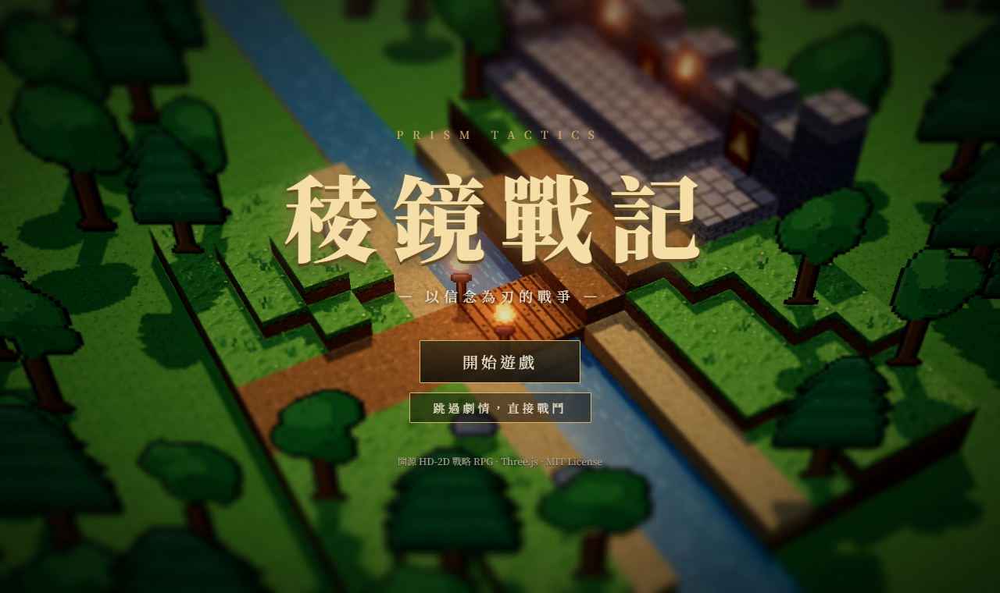
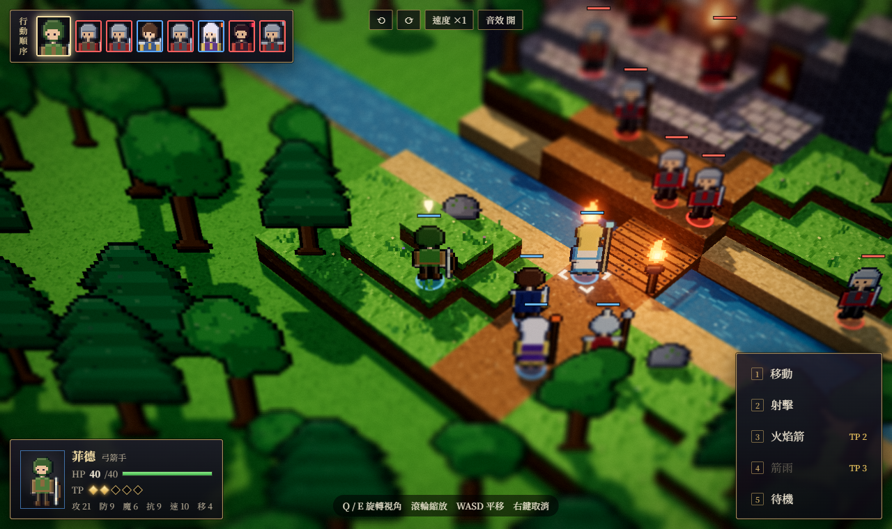
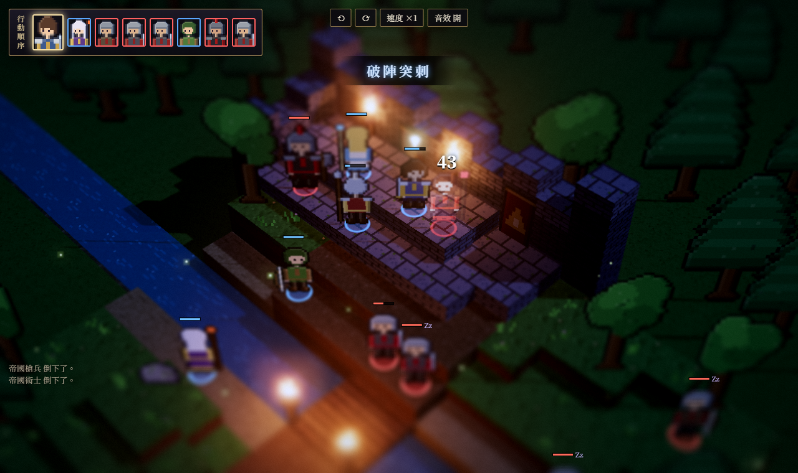
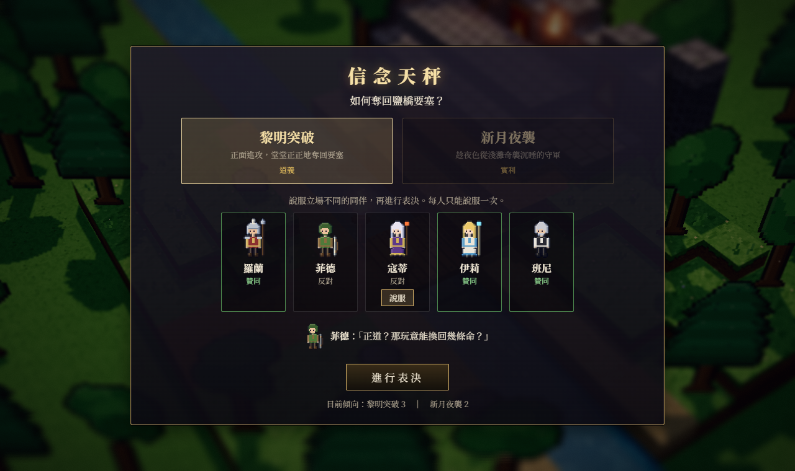

# 稜鏡戰記 Prism Tactics

開源的 **HD-2D 戰略角色扮演遊戲**，靈感來自《三角戰略》（Triangle Strategy）。以 [Three.js](https://threejs.org/) 打造，直接在瀏覽器中執行。

所有像素美術（角色、樹木、地形材質）都在執行時以程式繪製，**不含任何第三方美術素材**，整個專案以 MIT 授權釋出。



## 線上遊玩

推送到 `main` 後，GitHub Actions 會自動部署到 GitHub Pages：
`https://ywchen0711.github.io/prism-tactics/`

## 特色

**HD-2D 畫面**
- 2D 像素角色以看板（billboard）方式立於 3D 立體透視模型（diorama）之中，會投射陰影、接受動態光源
- 移軸景深（tilt-shift）、泛光（bloom）、色彩分級、暗角與膠片顆粒後製
- 火把點光源閃爍、水面流動、飄浮的塵埃與螢火蟲粒子
- 白晝與新月夜晚兩種光照氛圍

**戰略系統（致敬《三角戰略》）**
- **高低差**：居高臨下傷害與命中提升，弓箭手居高時射程 +1；跳躍力決定能否攀上高台
- **方向與背擊**：從背後發動的物理攻擊必定暴擊，側面攻擊亦有加成
- **追擊**：同伴站在敵人正對面時，會自動發動追擊
- **TP 系統**：每回合累積 TP，施放技能需要消耗
- **行動順序**：依速度決定的時間軸；不移動或不行動可以更快輪到下一回合
- **元素地形互動**
  - 火焰會點燃草地，站在火上會被灼傷
  - 冰晶槍會凍結河面，製造可以通行的冰道；火焰能融化冰
  - 落雷會沿著水面、淺灘與濕沙傳導，波及所有相連的敵人
- **信念天秤**：戰前由同伴投票決定作戰方針。說服立場不同的同伴（每人只有一次機會，要找出打動對方價值觀的論點），表決結果決定戰役：
  - 黎明突破：白晝正面進攻（困難）
  - 新月夜襲：多數守軍在睡夢中（普通）





## 操作方式

| 操作 | 按鍵 |
| --- | --- |
| 選擇／確定 | 滑鼠左鍵 |
| 取消／返回 | 滑鼠右鍵、Esc |
| 選單指令 | 數字鍵 1–9 |
| 旋轉視角 | Q / E，或右鍵拖曳 |
| 平移視角 | WASD／方向鍵 |
| 縮放 | 滑鼠滾輪 |
| 確定面向 | Enter |
| 切換 2 倍速 | F |

## 本機開發

需要 Node.js 18 以上。

```bash
npm install
npm run dev        # 開發伺服器
npm run build      # 輸出至 dist/
npm run simulate   # 無畫面 AI 對 AI 平衡測試
```

除錯參數：`?battle=A` 或 `?battle=B` 直接進入戰鬥，加上 `&auto=1` 讓我方也由 AI 操作。

## 專案結構

```
src/
  main.js      進入點、輸入處理、遊戲流程
  world.js     HD-2D 渲染器：地形網格、看板角色、光源、後製特效、攝影機
  pixelart.js  程序化像素美術（角色、樹木、地形材質）
  battle.js    規則、行動順序、玩家操作狀態機、敵方 AI
  fx.js        粒子、傷害數字、投射物、落雷、地形狀態效果
  map.js       戰場資料（高度、地形種類、裝飾物）
  data.js      職業、技能、角色配色、兩種戰役配置
  story.js     劇情對話與信念天秤
  ui.js        HUD 介面
  audio.js     WebAudio 程序化音效
tools/
  simulate.mjs 無畫面平衡模擬
```

## 授權

[MIT](LICENSE)。本專案為粉絲向的原創作品，與 Square Enix 或《三角戰略》官方無關，未使用任何原作素材、角色或名稱。
